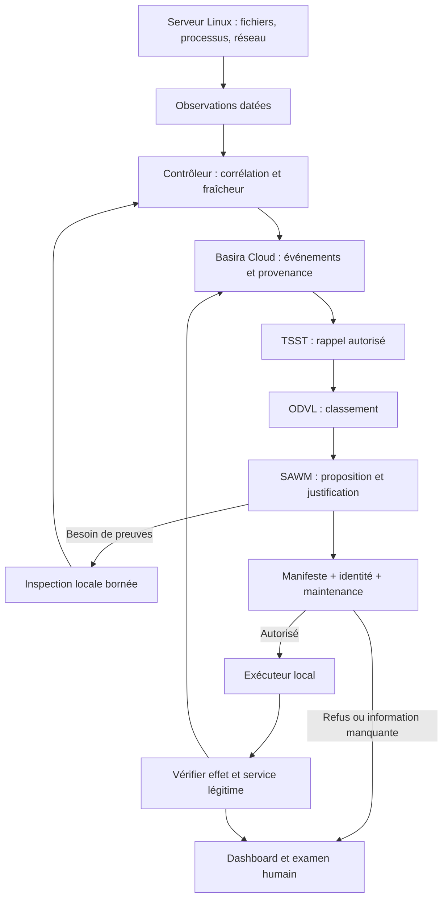

# Architecture : de l'observation à l'effet vérifié

[Retour au README](../README.md)

La Salle des Machines sépare trois responsabilités : **observer le système**, **choisir une réponse** et **posséder le droit de l'exécuter**. Cette séparation permet d'expliquer une décision et de refuser une proposition incorrecte sans supprimer l'enquête.

## Les composants

| Composant | Responsabilité | Ce qu'il ne décide pas |
| --- | --- | --- |
| Capteurs Linux | Événements noyau, journaux, processus, fichiers et mesures de ressources. | Une observation ne crée pas une permission d'intervention. |
| Contrôleur | Corrélation, fraîcheur, budget, sélection d'incidents et inspections. | Il ne transforme pas une donnée manquante en absence de menace. |
| Basira Cloud | Dépôt d'événements et rappel avec provenance dans l'espace autorisé. | Un dépôt réussi ne certifie pas la véracité d'un événement. |
| TSST | Rappel multidimensionnel demandé via l'API, après contrôle des droits. | Une indisponibilité du moteur ne signifie pas mémoire vide. |
| ODVL | Classement des éléments rappelés et observations du vortex. | Le premier rang n'est ni un verdict ni une autorisation. |
| SAWM Cloud | Lecture des preuves, choix d'inspections, proposition structurée. | Il n'exécute pas directement de commandes dans Linux. |
| Exécuteur local | Validation indépendante et application des actions déléguées. | Il n'accepte pas de commande arbitraire fournie par le modèle. |
| Vérification et audit | Mesurer l'effet, enregistrer les reçus et montrer les limites. | Une fin naturelle de tâche n'est pas un succès de confinement. |

## Une boucle complète

Le connecteur dépose les événements via `events:batch`, attend le job d'ingestion, puis rappelle les preuves via `recall:tsst`. La projection du moteur peut suivre l'ingestion de manière asynchrone : le code distingue ces étapes et effectue des reprises bornées.

Un tour SAWM est consommé jusqu'à son événement terminal `turn.done`. Un morceau de réponse interrompue ne devient pas une action. Le même `turn_id` et le même corps servent à reprendre un tour de manière idempotente. Les preuves rappelées par le connecteur sont distinguées de celles rappelées nativement par SAWM, pour ne pas les compter deux fois.

## Décisions et inspections disponibles

Le contrat du connecteur reconnaît notamment :

- `inspecter-processus`, `inspecter-compte`, `inspecter-connexions`, `inspecter-base` ;
- `ne-rien-faire`, `ouvrir-dossier`, `demander-clarification` ;
- `geler-transfert`, `limiter-cpu`, `arreter-service`, `revoquer-jeton` ;
- `verifier-integrite`, `restaurer-fixtures`.

Ce catalogue décrit les propositions possibles. **Le manifeste local possède sa propre liste d'actions autorisées**, éventuellement restreinte par unité. `geler-transfert` arrête l'unité de transfert ciblée du laboratoire ; il ne constitue pas un filtre général de tout le trafic d'un port. `restaurer-fixtures` concerne les données de démonstration déclarées, pas une restauration automatique de données clients.

Une proposition inclut une cible, une justification publique, des preuves citées et des inconnues. Son score de confiance n'est pas une probabilité calibrée de malware. Le dashboard présente les motifs publics et les faits, pas un raisonnement privé du modèle.

## Où les composants tournent

**Parcours de référence :** les capteurs et l'exécuteur résident dans Linux ; le contrôleur peut résider sur un poste distinct ; les modèles et moteurs mémoire sont appelés dans le Cloud. Le transport administratif vers Linux utilise une cible SSH explicite et une clé dédiée.

**Mode local explicite :** `SAWM_LABO_LOCAL_VM=1` permet certains contrôles directement dans la VM Linux. Ce mode exige une installation déjà présente, détenue par root et non modifiable par des comptes non autorisés. Il ne procure pas l'indépendance d'un contrôleur situé hors de la machine surveillée.

La télémétrie TCP et le dashboard HTTP restent sur loopback par défaut. Pour un invité distant, utiliser un tunnel SSH ou un réseau privé isolé explicitement configuré. Le socket de télémétrie n'apporte pas à lui seul une authentification de la source.

## Ce que signifie « apprendre de l'expérience » ici

Les observations et effets peuvent être conservés puis rappelés lors d'une enquête ultérieure. Le contrôleur maintient également des dispositions heuristiques comme la vigilance et la confiance dans les preuves. Ces états orientent l'attention, jamais les permissions.

Cet archivage ne réentraîne pas automatiquement les poids d'un modèle. Un bénéfice causal de TSST, d'ODVL ou des dispositions sur la qualité des décisions demande une comparaison contrôlée, distincte de la simple réussite du raccordement.

## Repères dans le code

- [`connecteur/pont_memoire.py`](../connecteur/pont_memoire.py) : dépôt, jobs, rappel et classement.
- [`connecteur/tour_sawm.py`](../connecteur/tour_sawm.py) : tour Cloud complet et idempotence.
- [`connecteur/contrat.py`](../connecteur/contrat.py) : proposition typée.
- [`controleur/enquete_autonome.py`](../controleur/enquete_autonome.py) : inspections bornées.
- [`controleur/veille.py`](../controleur/veille.py) : boucle et budget durable.
- [`invite/executeur/executeur.py`](../invite/executeur/executeur.py) : dernier contrôle avant mutation.
- [`controleur/verification_action.py`](../controleur/verification_action.py) : vérification des effets.
