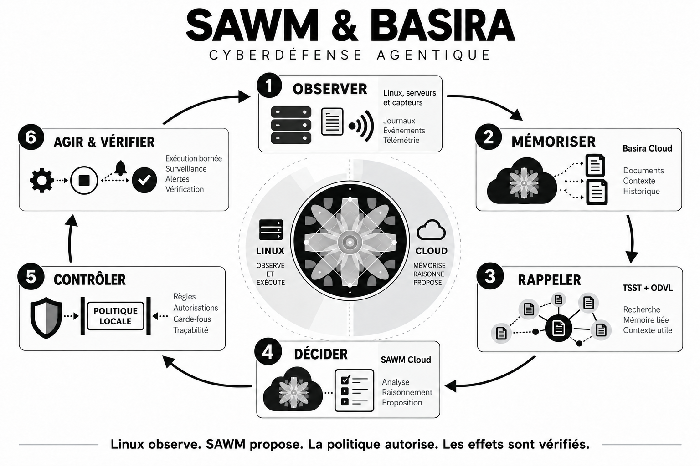

# Basira et SAWM pour une cyberdéfense agentique qui observe, intervient et vérifie

**Français** | [English](BASIRA-CYBERDEFENSE-MEDIUM-EN.md)

**Comment donner à un agent la mémoire des incidents de votre serveur et des moyens d’action contrôlés avec les API Basira et SAWM Cloud.**

Une base de données cesse de répondre. Un processus consomme davantage de ressources. Des connexions échouent, puis recommencent. Pour l’équipe informatique, la difficulté consiste à reconstruire la situation : qui a fait quoi, est-ce autorisé, quelle action préservera le service, et comment vérifier qu’elle a fonctionné ?

Avec **SAWM et Basira**, nous développons une boucle de cyberdéfense qui relie ces étapes. Les capteurs observent le serveur. La mémoire conserve les événements et les résultats des interventions. L’agent retrouve le contexte, peut demander des vérifications, puis propose une action dans le mandat de l’institution. Un exécuteur local contrôle cette autorisation et vérifie l’effet obtenu.

Le kit **Cyber Defense Agentique SAWM&Basira** est disponible sur [GitHub](https://github.com/SAWM-io/cyber-defense-agentique-sawm-basira). Il utilise les véritables API Cloud. Il permet à une équipe de construire un démonstrateur sur Linux, puis de qualifier son propre périmètre de défense.



*Le kit relie capteurs, mémoire, enquête, autorisation locale et vérification. Dans la campagne décrite ici, les capteurs et l’exécuteur sont dans une VM Linux ; le contrôleur et le dashboard tournent sur l’hôte.*

## Une mémoire qui conserve le contexte des incidents

Un même symptôme peut avoir plusieurs explications. Une forte activité disque peut venir d’une sauvegarde légitime. Un changement d’empreinte peut correspondre à une maintenance autorisée. Un verrou sur une base peut être temporaire ou rendre le service indisponible.

L’intérêt de Basira est de rendre les observations et les retours des interventions précédentes disponibles pour l’enquête suivante. L’agent peut retrouver ce qui a été signalé, la décision prise et le résultat rapporté, dans le périmètre auquel son principal a accès.

Les quatre composants ont des rôles précis :

- **Basira** conserve les événements et leur provenance.
- **TSST** retrouve les preuves pertinentes dans la mémoire autorisée.
- **ODVL** contribue au classement des éléments rappelés. Il n’ajoute aucune preuve et n’accorde aucun droit.
- **SAWM** examine le contexte, choisit des inspections ou une proposition d’intervention et fournit une justification publique.

Une observation ancienne reste une observation ancienne. Avant une intervention, le système doit vérifier la situation actuelle du serveur. La mémoire et les capteurs se complètent.

## Un exemple réellement exécuté

Le 26 octobre 2026, nous avons testé cette chaîne dans une VM Linux, avec une base SQLite fictive et les API Cloud réelles.

Un processus détenait un verrou exclusif qui empêchait les opérations sur la base. L’enquête a établi le lien entre ce verrou et l’unité concernée, vérifié les autorisations, puis transmis les éléments à SAWM.

SAWM a choisi **l’arrêt du service responsable**. Un ticket signé a lié cette proposition à une cible et à une action précises. L’exécuteur local a revérifié le mandat et l’identité de la cible avant d’intervenir. Après l’arrêt, les lectures et les écritures ont été rétablies, le service témoin est resté disponible et le retour a été déposé dans Basira.

Le résultat démontré est concret : **une observation a conduit à une décision SAWM, puis à une action autorisée dont l’effet a été contrôlé**. Il ne s’agit pas d’une réponse textuelle simulant un arrêt. Les [preuves de campagne](https://github.com/SAWM-io/cyber-defense-agentique-sawm-basira/blob/main/docs/VALIDATION-VM-2026-10-26.md) précisent aussi les essais locaux, les incidents rencontrés et les limites.

## Une autonomie définie par le propriétaire du serveur

L’agent peut intervenir sans demander une confirmation à chaque incident lorsque cette intervention lui a été déléguée à l’avance. Le propriétaire définit les unités, fichiers et actions autorisés, les ressources protégées et les mandats de maintenance.

La proposition de SAWM ne suffit pas à exécuter une commande. Le contrôleur et l’exécuteur vérifient notamment l’autorité, la fraîcheur des preuves, l’identité de la cible, la maintenance en cours et la validité du ticket signé. Le modèle ne reçoit pas un shell root libre.

Cette séparation est essentielle : un nom de fichier ou un journal contenant une instruction reste une donnée à examiner. Il ne peut pas modifier le mandat de l’agent.

Des gardes locales disposent également d’un mandat limité pour certains cas, y compris lorsque le Cloud est indisponible. Le dashboard distingue leurs interventions des décisions prises par SAWM.

## Ce que le démonstrateur permet déjà de vérifier

La campagne comprend plusieurs mécanismes complémentaires :

- **Disponibilité d’une base** : attribution d’un verrou et arrêt ciblé, avec contrôle des lectures et écritures après intervention.
- **Intégrité d’un fichier ou d’une base** : détection d’un écart et confinement local du processus attribué. Restaurer les données reste une opération distincte.
- **Maintenance autorisée** : vérification d’un mandat signé et refus d’une intervention incompatible.
- **Authentification répétée** : sur le service de démonstration, cinq mots de passe incorrects ont conduit à une exclusion temporaire de la source ; son expiration et le retour de l’accès ont été vérifiés.
- **Observation SSH** : des connexions rejetées ont produit une alerte tout en préservant l’accès légitime. Cette sonde ne bannit pas automatiquement le port SSH.
- **Protection noyau** : une politique BPF LSM a refusé la lecture d’un fichier de test au processus visé, y compris root, tout en conservant une lecture témoin autorisée.

Le dépôt contient aussi des modules d’inspection des ressources, des connexions, de paquets `.deb` soumis avec ClamAV et de fichiers volumineux. Leur qualification dépend du scénario et du serveur cible. Un pic CPU n’est pas, à lui seul, une preuve de malware.

Un point reste à améliorer dans les choix SAWM : sur un cas de maintenance pourtant protégée, l’agent a demandé une clarification supplémentaire. Il n’a pas arrêté le processus, mais le critère d’autonomie complète de cet essai n’est pas satisfait.

## Connecter votre serveur aux API Cloud

### 1. Créer les accès de votre environnement

Dans [votre espace Basira](https://basira.sawm.io/espace), utilisez un compte autorisé pour créer un espace mémoire, une entité représentant le serveur et un principal de service dédié.

Accordez à ce principal les droits `read` et `write` sur l’entité concernée. Émettez ensuite une clé avec le profil **Runtime agent + SAWM**, comprenant les scopes suivants :

```text
events:write jobs:read memory:recall tsst:recall odvl:rank sawm:run
```

Les scopes API et les droits sur l’entité sont deux contrôles distincts. Une clé ne doit pas recevoir un accès global à tous les dossiers pour observer un seul serveur.

### 2. Installer et tester le connecteur

Sur votre poste de contrôle, avec Python 3.11 ou ultérieur, Git et Node.js pour les tests d’interface :

```bash
git clone https://github.com/SAWM-io/cyber-defense-agentique-sawm-basira.git
cd cyber-defense-agentique-sawm-basira
python3 -m venv .venv
. .venv/bin/activate
python -m pip install -r requirements-dev.txt
mkdir -p releves/rapports releves/series
python tests/run_safe.py
```

Cette suite vérifie le logiciel sans effectuer d’appels Cloud ni intervenir sur votre serveur.

### 3. Configurer le coffre privé

```bash
mkdir -p "$HOME/.sawm-labo"
chmod 700 "$HOME/.sawm-labo"
cp .env.example "$HOME/.sawm-labo/env"
chmod 600 "$HOME/.sawm-labo/env"
```

Renseignez ce fichier dans votre éditeur avec vos propres identifiants :

```dotenv
BASIRA_BASE=https://basira-api.sawm.io/api/v1/basira
BASIRA_SPACE=mem_REPLACE_WITH_YOUR_SPACE
BASIRA_ENTITY=ent_REPLACE_WITH_YOUR_ENTITY
BASIRA_PRINCIPAL=prn_REPLACE_WITH_YOUR_PRINCIPAL
BASIRA_KEY=REPLACE_WITH_YOUR_PRIVATE_SERVICE_KEY
```

Le connecteur lit directement ce fichier. Gardez-le hors du dépôt et des captures d’écran. Les clés de service doivent rester révocables et propres à l’environnement.

Voici un premier rappel réel, à exécuter à la racine du dépôt avec son environnement Python :

```python
from uuid import uuid4
from connecteur.pont_memoire import PontMemoire

bridge = PontMemoire(coffre="~/.sawm-labo/env", campagne=uuid4().hex)
try:
    recall = bridge.rappeler(
        "Quels incidents de disponibilité ont été observés ?",
        limite=5,
    )
    print({"preuves": recall.nombre, "moteur": recall.moteur})
finally:
    bridge.close()
```

Ce rappel utilise les événements déjà présents dans votre entité et n’agit pas sur le serveur. Les appels Cloud peuvent consommer des crédits ; une mémoire vide ne doit pas être confondue avec un moteur indisponible.

### 4. Installer les capteurs et relier Linux

Le kit s’appuie sur systemd, cgroup v2, `/proc`, journald et des outils réseau. Les sondes eBPF et BPF LSM nécessitent un noyau compatible. **SAWM et Basira ne sont pas installés dans le noyau : ce sont les sondes et les protections locales qui y interviennent.**

Le [guide de démarrage](https://github.com/SAWM-io/cyber-defense-agentique-sawm-basira/blob/main/docs/QUICKSTART.md) détaille la préparation d’une VM dédiée, les unités systemd, le transport, les clés SSH et la vérification de fraîcheur. Le préparateur refuse une installation existante et ne compile pas automatiquement les sondes avancées.

Vous pouvez héberger le contrôleur dans la VM ou sur un hôte distinct. Dans le second cas, configurez la cible SSH explicite, sa clé hôte vérifiée et le transport de télémétrie privé ou authentifié. Le dashboard reste sur loopback, accessible à distance par tunnel authentifié. Une commande de veille suppose ces raccordements déjà effectués.

### 5. Passer de l’observation à l’action

Sur le contrôleur configuré, démarrez le collecteur dans un premier terminal :

```bash
python controleur/collecteur.py
```

Ouvrez `http://127.0.0.1:8899/`. Dans un second terminal utilisant le même environnement Python, commencez par l’observation :

```bash
python controleur/veille.py --duration 60
```

Ajoutez ensuite l’analyse Cloud, sans intervention automatique :

```bash
python controleur/veille.py --duration 300 --cloud --cloud-per-hour 4
```

Après avoir validé le manifeste, enrôlé les clés et délégué les actions sur vos cibles de test, activez la veille continue :

```bash
python controleur/veille.py --permanent --cloud --apply --cloud-per-hour 4
```

Le drapeau `--apply` ne contourne aucun mandat. Le profil exige les signatures et les vérifications locales prévues. Le budget est persistant : quatre tours SAWM par heure dans cet exemple, pas quatre requêtes HTTP. Pour le mode entièrement local à Linux, le guide donne le préfixe `SAWM_LABO_LOCAL_VM=1`, le compte d’exécution et les chemins à utiliser.

## Ce que l’équipe retrouve dans le dashboard

L’interface rassemble la santé du serveur, la fraîcheur des capteurs, les incidents, les décisions, les reçus et les effets vérifiés. Les cartes repliables permettent d’examiner un événement sans perdre la vue d’ensemble.

Les appels Basira et SAWM Cloud y sont visibles avec leurs statuts, latences et tentatives. Les consommations apparaissent lorsqu’elles sont fournies par l’API. La campagne récente distingue les décisions SAWM, les gardes locales, les essais réussis et ceux qui nécessitent encore une correction.

Pour le responsable de sécurité, l’objectif est de pouvoir répondre à une question précise : **qu’avons-nous observé, pourquoi cette intervention était-elle autorisée et quel résultat avons-nous effectivement constaté ?**

## Défense en profondeur et référentiels

Le projet combine mandats, observations datées, inspections, tickets Ed25519, vérifications locales et journalisation. Cette défense en profondeur fournit des éléments utiles à un programme de sécurité.

Le [rapport client](https://github.com/SAWM-io/cyber-defense-agentique-sawm-basira/blob/main/docs/rapports/SAWM-Basira-Cyberdefense-Agentique-2026-10-26.pdf) présente les contributions possibles aux démarches [ISO/IEC 27001](https://www.iso.org/standard/27001), aux [CIS Controls](https://www.cisecurity.org/controls/cis-controls-list) et au vocabulaire [MITRE D3FEND](https://d3fend.mitre.org/faq/). Ces correspondances ne constituent pas une certification ISO ni une garantie de protection universelle.

Le kit public est sous licence Apache 2.0, avec un composant BPF LSM sous GPL-2.0-only. Les moteurs SAWM, Basira, TSST et ODVL restent propriétaires et accessibles par les services Cloud. Définissez le périmètre des données envoyées, leur conservation, les fournisseurs de modèle et les exigences de résidence avant un déploiement métier.

## Construire une expérience de défense vérifiable

Un pilote utile commence par quelques services représentatifs : une base à préserver, une maintenance à respecter, des connexions à observer et un service témoin à maintenir. Les critères portent sur les décisions justes, les faux positifs, les délais, les effets et la reprise après panne.

L’ambition de SAWM et Basira est de donner à la défense une continuité : conserver le contexte, agir dans un mandat explicite et réutiliser les résultats observés pour les enquêtes suivantes.

**Explorez le [dépôt public](https://github.com/SAWM-io/cyber-defense-agentique-sawm-basira), consultez le [guide Cloud](https://github.com/SAWM-io/cyber-defense-agentique-sawm-basira/blob/main/docs/CLOUD.md) et préparez votre environnement dans [l’espace Basira](https://basira.sawm.io/espace).**
